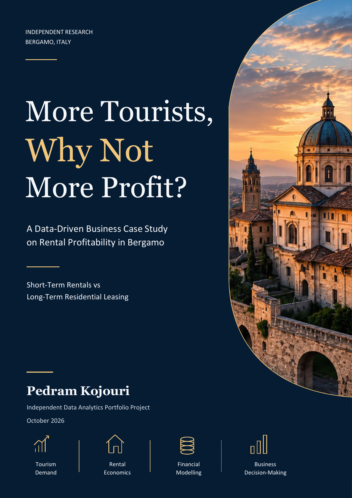

# More Tourists, More Profit?

**A Data-Driven Business Case Study on Rental Profitability in Bergamo**

Tourism is growing. Does converting a home to short-term accommodation leave an owner more annual cash than conventional residential renting?

This independent Data Analytics portfolio project joins official tourism and BGY airport trends with a manual online rental listing review and a reproducible financial model. A selected **14-property** comparable sample averages **€ 894.29 base rent/month**, with median **€ 850**. Using its unrounded mean, modelled long-term net is **€ 6,677.83**, compared with **€ 6,544.50** short-term. The **€ 133.33 annual gap** is too small, relative to unmeasured uncertainty, to establish a decisive market-wide winner.

<a href="reports/Bergamo_Rental_Strategies_Complete_EN_v03.pdf"></a>

## Interactive Power BI dashboard

Five native pages connect the screened rental evidence, tourism/BGY context and
an investment simulator with 12 working What-if controls. The design uses the
approved carousel's extracted palette and Aptos typography.

[**Open the PBIX**](powerbi/Bergamo.pbix) · [PBIP source](powerbi/Bergamo.pbip) ·
[Setup and usage](powerbi/README.md) · [Validation evidence](powerbi/validation/QA.md)


Validated in Power BI Desktop: 19 DAX scenarios, 114 numerical/blank checks,
all five pages reviewed, native parameter/reset/filter/navigation interactions
exercised. The imported PBIX works without a data refresh; configure the
`RepositoryRoot` parameter before refreshing on another machine.

## Read the project

- [Full research report PDF](reports/Bergamo_Rental_Strategies_Complete_EN_v03.pdf) and [editable Word report](reports/Bergamo_Rental_Strategies_Complete_EN_v03.docx)
- [LinkedIn carousel PDF](publication/Bergamo_LinkedIn_Carousel_EN_Final.pdf) and [editable PowerPoint](publication/Bergamo_LinkedIn_Carousel_EN_Final.pptx)
- [Complete audit of every candidate](reports/Rental_Listing_Investigation.md)
- [Primary comparable sample](data/rental/primary-comparable-sample.csv), [secondary sample](data/rental/secondary-sample.csv) and [record-level master registry](data/rental/master-listing-registry.csv)
- [Criteria and data dictionary](data/rental/data-dictionary.md), [source register](data/rental/source-register.csv), [identity decisions](data/rental/deduplication-decisions.csv) and [external benchmarks](data/rental/market-benchmarks.csv)
- [Financial and statistical outputs](results/rental-market-analysis.json), [historical model](results/analysis.json) and [separate contents](reports/Bergamo_Report_Contents_EN.pdf)

## Rental evidence and reconciliation

Review date: **14 October 2026**. Method: **Manual online rental listing review**. The geographic rule selects Comune di Bergamo advertisements labelled Centro or Sant'Alessandro, or explicitly located at Piazzetta Santo Spirito. These source-defined labels form an operational selection, not an official polygon or a city-wide sample.

| Evidence stage | Count |
|---|---:|
| Original candidate records | 21 |
| Preliminary research leads | 20 |
| Additional advertisements investigated | 55 |
| Total candidate rows | 96 |
| Distinct source URLs | 89 |
| Confirmed duplicate clusters / rows removed | 2 / 2 |
| Canonical groups including unresolved identities | 94 |
| Probable duplicate review pairs | 6 |
| Primary / secondary comparable properties | 14 / 11 |
| Excluded canonical groups, including unresolved | 69 |
| Unresolved candidate rows | 18 |

The complete physical-property count remains **unknown** for unresolved leads and probable duplicates. Canonical groups are record groups, not a confirmed count of independent apartments. The 20-property primary target was not reached; criteria were not weakened to obtain it.

The primary cohort contains furnished entire one-bedroom apartments of **40–65 advertised m²**, an explicit ordinary **4+4** contract, identifiable base monthly rent, and no unresolved material conflict. The secondary cohort separately admits 40–80 m² and other ordinary residential durations. Neither cohort contains serviced or transitory offers. Availability and executed contract prices were not confirmed with advertisers.

| Primary-sample statistic | Result |
|---|---:|
| Arithmetic mean / median | € 894.29 / € 850 per month |
| Total base rents / properties | € 12,520 / 14 |
| Sample standard deviation | € 180.59 |
| Minimum / maximum | € 650 / € 1,200 |
| Q1 / Q3 / interquartile range | € 755 / € 987.50 / € 232.50 |
| Mean / median rent per advertised m² | **€ 17.22 / € 18.48** |

Two original properties, two newly eligible preliminary leads and ten additional properties form the primary cohort. The recovered A05 lead overlaps C13 and does not add another apartment. Exact URLs and confirmed cross-platform identity edges merge; similar street or rent alone never triggers a merge. Sant'Orsola 25 is a confirmed duplicate with conflicting € 850/€ 900 headlines, so it is excluded. Borfuro 9 and two Camozzi offers remain probable reviews.

The [original 21 CSV](data/listings.csv) is unchanged: its 17 numeric historical prices total € 17,240 and average € 1,014.12. Four missing prices remain missing in that historical snapshot; separate new observations recover them. The preliminary 20 rows total € 17,185 and average € 859.25. These raw controls describe different, heterogeneous evidence sets, not the final comparable sample. The separate historical six-record subgroup has mean € 1,000 and median € 900.

Broseta 44's € 900 is an inclusive mid-term package. The suggested € 590 base split was not corroborated, so no base rent was inferred. Pignolo 23 explicitly states € 850 base plus € 50 reimbursement; its € 850 headline is not reduced a second time. A supplied Cucchi link now displays a studio elsewhere. These corrections remain visible in the audit.

## Financial comparison

| Annual model output | Historical € 900 rent | Evidence-informed € 894.285714… rent |
|---|---:|---:|
| STR net cash | € 6,544.50 | € 6,544.50 |
| LTR gross rent | € 10,800.00 | € 10,731.43 |
| LTR net cash | € 6,732.00 | € 6,677.83 |
| STR minus LTR | −€ 187.50 | −€ 133.33 |

Historical inputs and calculations remain unchanged. The new illustration changes only the LTR rent, using the full-precision primary mean. `LTR_net = 12 × rent × (1 − 0.21) − 1800`. Both models assume 12 paid months and eligible tax. They describe conditional cash outcomes, not observed property profits.

STR retains 180 booked nights, 330 available nights,€ 115 gross nightly revenue, 15.5% host fee, 21% eligible tax,€ 30 owner-paid cleaning per turnover at a three-night stay,€ 10 other variable expense per booked night and € 3,000 fixed costs. LTR retains € 1,800 annual owner costs. There is no owner-time deduction. Acquisition, financing, professional management and incremental preparation are outside base operating cash.

At € 115 per night, no additional setup requires **183 booked nights** for parity under the new rent, versus 184 historically. With € 15,000 additional preparation recovered over 5 years, requirements are **240 versus 241**. At 180 bookings, new gross nightly-price requirements are **€ 116.17** without extra setup and **€ 142.41** with that preparation. These are thresholds, not forecasts. Eleven paid LTR months reduce the new net to € 5,971.34. [Rent and differential-cost sensitivity](results/rental-market-analysis.json) show how modest changes can reverse the ranking.

## Tourism and independent market context

Official city guest nights rose 52.7% from 2019 to 2024. BGY's 2025 passenger movements fell 2.4% while city guest nights rose 12.6%. Airport passengers are not city apartment reservations; no causal airport-to-profit effect is estimated. Monthly tourism supplies a seasonal allocation of assumed bookings, not observed apartment occupancy.

September 2026 indicators are € 14.90/m² for Idealista Centro Città,€ 14.20 for its city series,€ 14.31 for Immobiliare's combined Borgo Palazzo/Centro/Stazione zone and € 13.57 for its city series. Idealista's revised methodology aggregates filtered microzone medians; the sample uses an arithmetic mean of individual rents. Housing mix and geographic boundaries differ.

Official OMI B2 civil-dwelling ranges, read from the interactive table, are **€ 9.70–12.50** for normal condition and **€ 12–15** for excellent condition per net m²/month in **2025-S2**. They are a different-period, condition-specific reference, not a September 2026 asking-rent index. [Benchmark provenance](data/rental/market-benchmarks.csv) records source, period, category, geographic scope and measurement basis.

## Reproduce

Core computations and all 50 tests use Python's standard library:

```sh
python src/analysis.py
python src/airport_analysis.py
python src/rental_market_analysis.py
python -m unittest discover -s tests -v
```

For report and figures:

```sh
python -m pip install -r requirements.txt
python src/rental_figures.py
python src/build_report.py
```

Report rebuilds go to ignored `generated/report/`, preserving published assets. Refresh Word's contents field before exporting PDF with Microsoft Word or compatible software. The Python builder does not export PDFs. [Publication manifest](data/publication-manifest.json) guards both historical assumptions and reviewed rental inputs. Do not update fingerprints without reviewing dependent narrative and publication material.

[Release validation](results/reconstruction-validation.json) records the 45 passing tests, preserved historical inputs, editable-chart checks, PDF page counts and changed file paths. Word and PowerPoint supplied the final native PDF exports; the report has 33 pages and the carousel nine slides.

[rental_market_analysis.py](src/rental_market_analysis.py) owns cohort statistics and the separate financial scenario; it shares formulas with [financial_model.py](src/financial_model.py). [rental_figures.py](src/rental_figures.py) plots canonical outputs. The Word cover keeps editable text and original schematic architecture generated by [report_cover.py](src/report_cover.py), not a photograph or surveyed skyline. The supplied carousel remains editable, including native charts and their workbooks.

## Limits and reuse

This is a selected convenience sample, with indexed/cached pages and varied advertisement update dates. All supplied candidates remain in the audit, including expired, unsuitable and unresolved records. No exact geocoding, agent confirmation, executed-rent sample or causal neighbourhood premium is available. Amenities, bundled parking, condition and differing surface definitions remain. Provider-wide indicators do not resolve those differences.

Historical 2024 STR estimates and 2026 asking rents cover different periods. FULL's Airbnb estimates derive from AirDNA and are not independent corroborations. Regional and local 2024 releases differ slightly, including 27 October guest nights; that discrepancy remains documented. Scenario combinations are not confidence intervals or guaranteed attainable bookings.

Sources include [Regione Lombardia monthly tourism](https://www.dati.lombardia.it/d/mzxz-sz25), [annual controls](https://www.dati.lombardia.it/d/vyxt-7jdx), [Provincia di Bergamo 2025 release](https://www.provincia.bergamo.it/cnvpbgrm/po/mostra_news.php?area=H&id=2591), [Assaeroporti](https://assaeroporti.com/statistiche/?month=12&selectedYear=2025), [Idealista](https://www.idealista.it/sala-stampa/report-prezzo-immobile/affitto/lombardia/bergamo-provincia/bergamo/) and [Immobiliare.it](https://www.immobiliare.it/mercato-immobiliare/lombardia/bergamo/). The report and source register link the full evidence.

Snapshots contain attributed public facts and aggregate numbers, not proprietary bookings, copied full listing descriptions or private advertiser contacts. Source rights and terms apply; no repository-wide reuse licence has been selected.

**Pedram Kojouri** · Independent Data Analytics Portfolio Project · Bergamo, Italy

[LinkedIn](https://www.linkedin.com/in/pedram-kojouri/)
