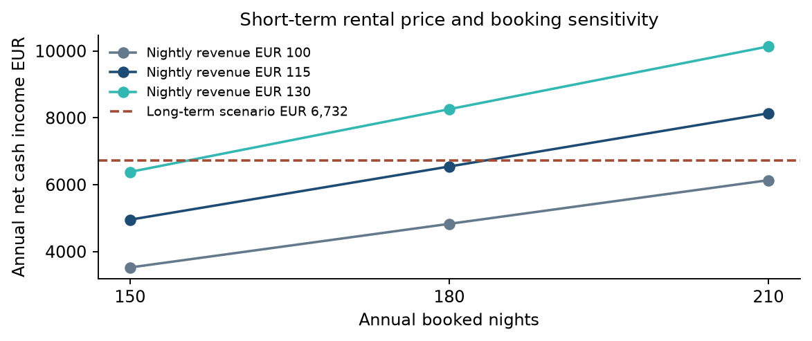

# Rental Strategies in Bergamo

**Does tourism growth make short-term renting more profitable than a residential lease?**

This study combines City of Bergamo tourism data, BGY airport traffic, rental listing screening and a cash-income model to compare rental strategies for an owner.

| Illustrative base scenario | Annual net cash income |
|---|---:|
| Short-term rental | €6,544.50 |
| Long-term residential rental | €6,732.00 |
| Short-term minus long-term | −€187.50 |

These are scenario results, not observed market-average profits. The small difference does not support a confident ranking. Bookings, realised nightly revenue, the alternative residential rent and additional expenses can reverse the result. Conversion costs raise the required surplus.

## Project outputs

- [Complete report](reports/Bergamo_Rental_Strategies_Complete_EN_v03.pdf) and [editable Word version](reports/Bergamo_Rental_Strategies_Complete_EN_v03.docx)
- [Nine-page LinkedIn summary](publication/Bergamo_LinkedIn_Carousel_EN_Final.pdf) and [editable presentation](publication/Bergamo_LinkedIn_Carousel_EN_Final.pptx)
- [Shared financial model](src/financial_model.py), [tourism and cash analysis](src/analysis.py), [airport comparison](src/airport_analysis.py), and [15 regression tests](tests/test_analysis.py)
- [Scenario inputs](data/assumptions.json), [listing screening](data/listings.csv), [financial results](results/analysis.json), and [airport results](results/airport-comparison.csv)



## Analytical approach

The analysis reconciles 72 monthly city observations for 2019–2024 with six annual controls, allocates assumed bookings using historical seasonality, and compares net cash under alternative prices, bookings, residential rents, operating budgets and preparation costs. A separate join compares seven annual BGY passenger totals with city arrivals and guest nights.

City guest nights grew 52.7% between 2019 and 2024. In 2025, airport passenger movements declined 2.4% while city guest nights grew 12.6%. Airport activity cannot substitute for property reservation evidence. No causal airport effect is estimated.

The business value is a transparent comparison of revenue, expenses and the rental alternative before an owner commits to conversion.

## Reproduce

The core scripts and tests use Python's standard library. Tested on Python 3.12.14.

```sh
python src/analysis.py
python src/airport_analysis.py
python -m unittest discover -s tests -v
```

The scripts run offline and regenerate the three files in `results/`. Production validation remains active with `python -O`. Inputs live in `data/assumptions.json`; cash and break-even formulas live in `src/financial_model.py` and are shared with report generation.

To rebuild the report and eight figures:

```sh
python -m pip install -r requirements.txt
python src/build_report.py
```

The tested report dependencies are pinned. Rebuilds go to ignored `generated/report/`, preserving published assets. The frozen narrative is protected by a canonical input fingerprint in [publication-manifest.json](data/publication-manifest.json). Changed assumptions require a reviewed narrative update. Refresh Word's contents field before PDF export; Microsoft Word or compatible software is required. The Python builder does not export PDFs. The carousel is supplied as an editable PPTX, without a portable automated authoring pipeline.

## Assumptions and limitations

The short-term base assumes 180 booked nights, 330 available nights, €115 gross nightly revenue, a 15.5% host fee and eligible 21% income tax. Owner-paid cleaning costs €30 per turnover with a three-night stay. The €115 input is reference-informed, not verified comparable realised gross ADR. Tourism seasonality estimates timing rather than proving the annual booking total.

The model excludes owner-time valuation, financing, acquisition and professional management. Fixed-cost allowances are illustrative budgets. Legal eligibility and actual expenses require property-specific verification.

Six of 21 rental candidates form the primary furnished 4+4-option cohort. Its €900 asking-rent median is not a city benchmark; the 15–30 comparable-offer target remains unmet. Historical short-term estimates and 2026 asking rents cover different periods. FULL's Airbnb estimates derive from AirDNA and are not independent corroborations. Sensitivity combinations are not forecasts or confidence intervals.

## Sources and reuse

[Regione Lombardia monthly tourism](https://www.dati.lombardia.it/d/mzxz-sz25), [annual controls](https://www.dati.lombardia.it/d/vyxt-7jdx), [Provincia di Bergamo 2025 release](https://www.provincia.bergamo.it/cnvpbgrm/po/mostra_news.php?area=H&id=2591), and [Assaeroporti traffic tables](https://assaeroporti.com/statistiche/?month=12&selectedYear=2025) provide the principal aggregate series. The report lists all research, listing and regulatory citations.

Regional and local 2024 releases differ slightly, including 27 October guest nights. The discrepancy remains documented. Snapshots contain attributed aggregate numbers and tabulated listing facts, not proprietary reservation records or copied listing descriptions. Provider rights and terms still apply; no repository-wide reuse licence has been selected.

`src/` contains calculations and report generation; `data/` contains frozen evidence and assumptions; `results/` contains computed outputs; `figures/` contains eight charts; `reports/` contains the complete study and requested separate contents; `publication/` contains LinkedIn assets. No empty notebook folders or development logs are included.

[Pedram Kojouri on LinkedIn](https://www.linkedin.com/in/pedram-kojouri/)
