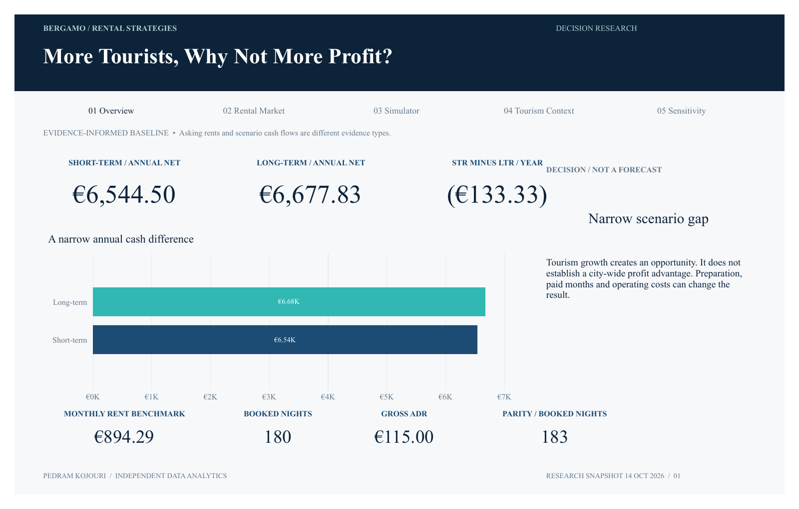

# More Tourists, Why Not More Profit? — Power BI

[Approved research report](../reports/Bergamo_Rental_Strategy_FINAL_2026.pdf) · [Project overview](../README.md)

Five editorial report pages extend the approved report and LinkedIn identity:
Overview, Rental Market, Simulator, Tourism Context and Sensitivity.

## Open and refresh

For an immediate review, open **[Bergamo.pbix](Bergamo.pbix)**. It was saved by
Power BI Desktop, reopened and checked against Python. Its imported evidence is
included, so viewing and using the simulator do not require a refresh or login.
For a maintainable source project, use [Bergamo.pbip](Bergamo.pbip).

1. Download or clone the **whole repository**, retaining `data/` and `results/`.
2. From the checkout, run `python powerbi/configure_source.py`.
3. Open `powerbi/Bergamo.pbip` in a recent Power BI Desktop supporting PBIP,
   PBIR and TMDL. Refresh the model before using a clone without a local cache.

`RepositoryRoot` is the sole configurable Power Query filesystem parameter.
The portable source edition uses the documented `C:\BergamoRentalAnalysis`
location until configured. No personal-machine path is required by the published
source. Changing the path does not change the analytical assumptions.
The PBIX also uses this portable parameter: before refreshing it on another
machine, use **Transform data → Edit parameters → RepositoryRoot** and select
the full repository checkout. The Python configurator changes PBIP source only;
it does not edit the packaged PBIX.

Install/enable **Aptos** locally for the exact approved typography, then restart
Power BI. Fonts are not embedded or redistributed. All five pages were reviewed
in Desktop **2.158.1304.0**, with Aptos available. Maximize the Desktop window and
collapse its editing panes for a comfortable reading area.

Raw canonical CSV/JSON inputs are read directly. Power Query selects and types
the evidence columns; it does not collect new observations or infer missing
rents. A many-to-one relationship connects candidate records to canonical
listing groups. Tourism is intentionally independent of listing occupancy.

## Use the report

- Navigate using the masthead actions or the native page tabs. In Desktop edit
  mode, action buttons require **Ctrl + click**, or select a button and press
  **Ctrl + Enter**. Native page tabs do not require a modifier.
- Rental Market is locked to the primary cohort. Neighborhood, platform and
  advertised-area slicers filter that cohort. Tables expose direct source URLs.
  Canonical groups must not be interpreted as verified physical-property totals.
- Simulator provides disconnected What-if parameter tables for bookings, ADR,
  LTR rent, host fee, eligible tax, cleaning, stay length, variable costs and STR
  fixed costs, plus LTR fixed costs, paid months and preparation. Single-value
  selections feed reusable DAX measures. Clearing selections returns baseline
  measures; an unselected dropdown is not itself an observed market value.
- STR fixed costs are the **total** STR allowance; LTR fixed costs are the LTR
  owner allowance. Change each deliberately. Cleaning remains owner-paid.
- The simulator's page-local selections do not silently alter other pages.
  Overview and Sensitivity retain their documented baseline. Risk cases are
  independent stress axes, not occupancy forecasts or confidence intervals.
- Invalid threshold conditions return blank: zero bookings for required ADR,
  non-positive contribution for required nights, zero paid months for LTR rent.
- Preparation is incremental to the LTR alternative and uses the preserved
  five-year simple recovery horizon. No owner-time cost is deducted.

## Preserve historical and current evidence

The selected-sample mean is computed from eligible canonical properties at full
precision. The historical €900 scenario remains in separate measures. No
listing, conclusion, utility assumption or financial research output is altered
by report filters. Tourism and airport movements remain contextual series.

## Engineering and validation

- `build_dashboard.py`: reproducible source authoring, exact design extraction,
  PBIR visual queries, TMDL tables/measures and theme generation. It regenerates
  authored definitions, so do not run it over unique manual design changes.
- `configure_source.py`: modifies only the configurable source path.
- `model_reference.py`: Python reference cases using the validated financial
  functions; generate expected outputs with `python powerbi/model_reference.py`.
- `validate_project.py`: Microsoft public JSON-schema validation. Install
  `jsonschema` if needed; downloaded schemas stay under ignored `generated/`.
- `validate_desktop.ps1`: actual DAX execution through the Desktop local engine.
  Requires PowerShell 7 and Microsoft's official .NET 8 ADOMD client assembly.
  Supply the current local engine port, database identifier and assembly path;
  these ephemeral identifiers are intentionally not stored in the project.

Keep local `.pbi` caches and session settings out of Git. Schema validation,
Desktop refresh, DAX comparison and actual-page visual review are distinct checks;
the validation files record what was actually tested. No HTML mockup replaces
the native report.
## Delivered model and acceptance checks

- Five pages, 25 tables, 60 reusable measures and 12 native parameter controls.
- 19 actual Desktop DAX cases / **114 numerical or blank checks**, including
  every parameter, historical €900 rent, combined changes and invalid thresholds.
- All five native pages rendered and individually reviewed. The sensitivity
  matrix displays nine calculated cells with conditional fills; no visual errors.
- Native interaction verified: ADR €115 → €50 changed STR cash from €6,544.50
  to −€885.00; reset restored the base outputs. Masthead navigation worked.
  Piazzetta Santo Spirito filtering returned one €850 property; clearing filters
  restored 14 properties and the €894.29 mean.
- Official authoring validation: **zero errors and zero warnings**. Public
  Microsoft schemas and regression tests are checked separately.
- Existing data, financial Python, results, reports and publication assets are
  unchanged. [Validation notes](validation/QA.md) distinguish the evidence.

The narrow-gap wording uses a €500 presentation band; it is not a researched
investment hurdle, confidence interval or recommendation. The selected baseline
cell is gold. Other positive cells use pale teal and negative cells use the
project divider shade. Signs and numbers convey the result independently of color.
Risk headings identify row nights and column gross ADR; the native row header
uses the underlying parameter column name `Value`.

## Actual Desktop previews

These are supporting captures of the live native report, not mockups.



[Rental Market](previews/02-rental-market.png) ·
[Simulator](previews/03-simulator.png) ·
[Tourism Context](previews/04-tourism-context.png) ·
[Sensitivity](previews/05-sensitivity.png)

The source authoring tools used for the final structural/layout check were
Microsoft `powerbi-report-author` 0.5.0 and `powerbi-desktop` 1.0.0. They are
optional development dependencies, not required to open the PBIX. Python's
standard library runs the model references and the repository's unit tests.
`validate_project.py` additionally requires `jsonschema` / `referencing`.

To run the portable checks from the repository root:

```sh
python -m unittest discover -s tests -v
python powerbi/model_reference.py
python powerbi/validate_project.py
```

A refreshed snapshot or changed model requires a new actual-engine validation
and a new Desktop Save As; rebuilding PBIP source does not regenerate the PBIX.

## Final publication update — 16 October 2026

The Overview title was edited and saved in Power BI Desktop to match the final report. The PBIP title and generator literal match. A native five-page PDF export supplied the updated Overview preview. All other previews remain the earlier validated captures. Package comparison confirms the imported DataModel is byte-identical; only the Overview textbox definition and Desktop security binding changed. No refresh, DAX, relationship, Power Query, parameter or interaction change was made. Existing Desktop numerical evidence remains historical; this release adds package-integrity and unit checks, not a new claim that all interaction scenarios were repeated.

The new Overview export renders with a serif fallback despite Aptos remaining specified and registered locally. The rendering cause was not established in this publication task. No font definitions were changed to compensate; the earlier previews retain their validated typography. See [release validation](../docs/final-release-validation.md).
